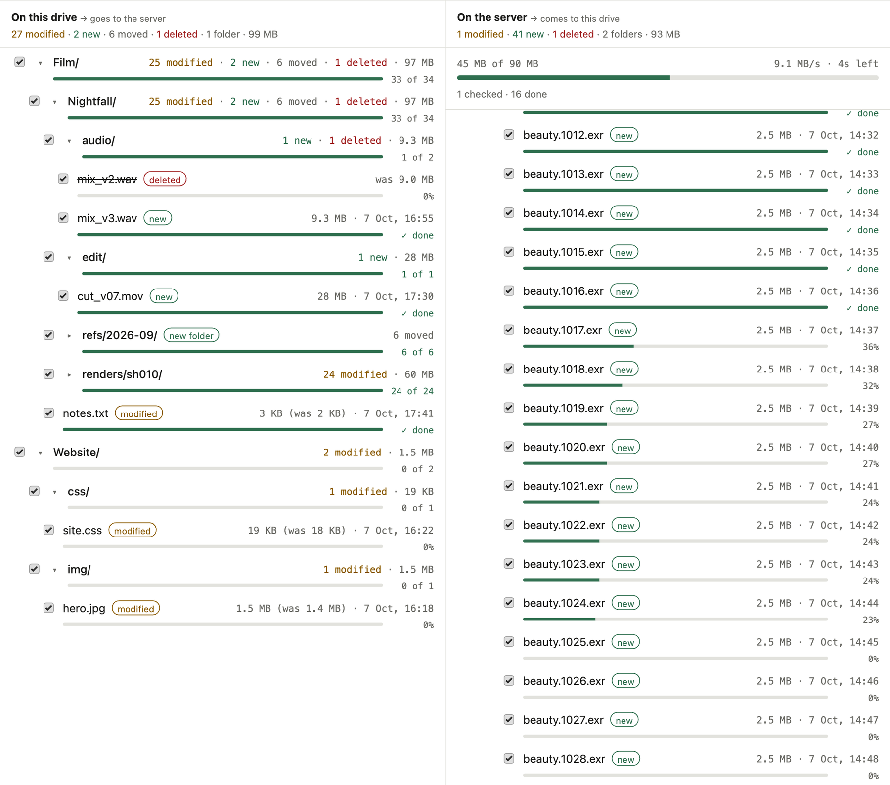
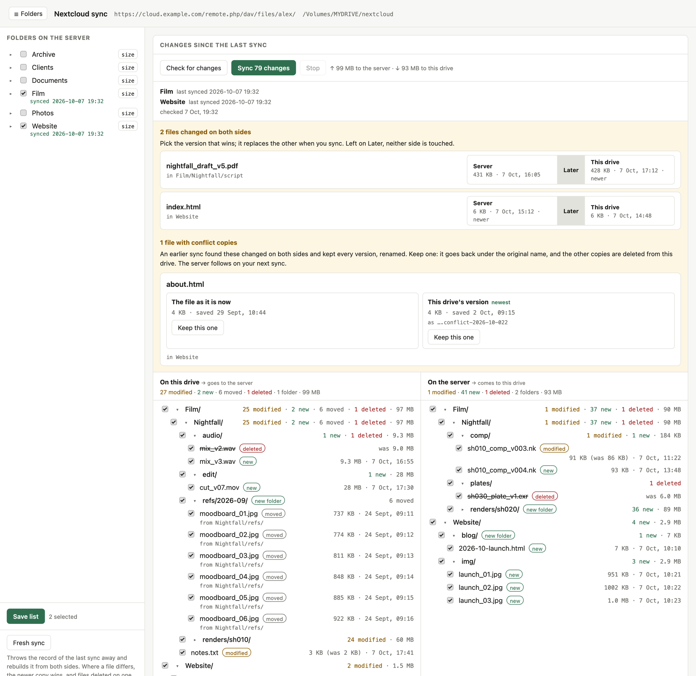

# ncsync

A manual, selective, two-way Nextcloud sync for a portable drive, for macOS
and Linux. Nothing runs in the background: you pick the folders and run the
sync when you want it. It is built on `rclone bisync`, and comes with a small
browser page that shows what changed on both sides and lets you choose which
changes go through, a bit like staging files in git.

It was built for an exFAT drive that moves between a Mac and a Linux machine,
holding a few large project folders from a slow Nextcloud server. The
Nextcloud desktop client rescans everything on every launch and cannot share
one sync folder between two computers. This can.



```
nextcloud/            any folder on the drive, any name
  _sync/              this repository
    ncsync            the sync, in the terminal
    ncweb             the same in the browser: review changes, pick what syncs
    setup.sh          run once: connects to your server
    inventory         asks the server which folders exist and how big they are
    filters.txt       what never syncs (OS junk, lock files)
    folders.txt       the folders you sync (written by ncweb, or by you)
    rclone.conf       server address and app password (written by setup.sh)
    state/            the record of the last sync
    logs/             one log per run
  files/              your synced folders land here
  .repo-id            marks the drive as set up
```

The key design decision is that `state/` lives on the drive, not in your home
folder. That is what lets two machines take turns, without either one
mistaking the other's changes for deletions.


## What you need

- macOS or Linux, with bash.
- **rclone 1.74.2 or newer.** Distribution packages are usually older, and
  the version check will reject them:

      macOS    brew install rclone
      Linux    curl https://rclone.org/install.sh | sudo bash

- Python 3.8 or newer for the browser page. macOS and most Linux systems
  already have it. Nothing needs to be installed with pip.
- A Nextcloud account that can create app passwords.


## Setup

1. Put this repository on the drive, in a folder named `_sync` inside the
   folder that should hold your files:

       git clone https://github.com/robinbenito/ncsync.git /Volumes/MYDRIVE/nextcloud/_sync

   You can also download the ZIP and unpack it there. Your files go to
   `files/` next to `_sync`.

2. Create a Nextcloud **app password**. Do not use your login password:
   Settings → Security → Devices & sessions → Create new app password.

3. Run the setup script:

       bash /Volumes/MYDRIVE/nextcloud/_sync/setup.sh

   It confirms where your files will go, asks for the server address, your
   login name and the app password, and then checks each step: that the
   server is reachable, that the login works, and that it can list your
   folders. It writes `rclone.conf` onto the drive, so a second machine can
   use the same config.

4. Pick folders in the browser:

       python3 /Volumes/MYDRIVE/nextcloud/_sync/ncweb

   Tick folders under **Folders on the server** and press **Save list**. The
   page then shows what the first sync would bring down. Press **Sync**.

   Or list the folders in `_sync/folders.txt`, one per line, as they appear
   on Nextcloud, and run `bash _sync/ncsync`:

       Documents
       Projects/2026/Website

   Each folder mirrors to `files/<same path>`. Do not list a folder together
   with something inside it; list one or the other. Blank lines and `#`
   comments are ignored.

The first sync of a big folder takes a while. When `ncsync` syncs a folder
for the first time, nothing gets deleted: where a file differs, the newer
copy wins.

To push a local folder that is not on the server yet, create it on the server
first:

    rclone --config _sync/rclone.conf mkdir nc:Projects/New

### The second machine

Install rclone, mount the drive, and run the tools. The config and the sync
record are already on the drive.

On Linux, mount the drive so your user owns the files:

    sudo mount -t exfat /dev/sdX1 /mnt/drive -o uid=$(id -u),gid=$(id -g),umask=022

### Updating

    git -C /Volumes/MYDRIVE/nextcloud/_sync pull

Git ignores `folders.txt`, `rclone.conf`, `state/` and `logs/`, so an update
never touches them.


## Daily use

    bash _sync/ncsync                 sync everything in folders.txt
    bash _sync/ncsync -n              dry run: show changes, touch nothing
    bash _sync/ncsync Documents       just that folder
    bash _sync/ncsync --status        what is configured, when it last ran
    bash _sync/ncsync --resync X      rebuild the sync record for folder X
    bash _sync/inventory [folder]     folder sizes, straight from the server

Run the scripts with `bash`. exFAT cannot store the executable bit, so
`chmod +x` will not last.

An alias in your shell config saves typing:

    alias ncsync='bash /Volumes/MYDRIVE/nextcloud/_sync/ncsync'


## The browser page

    python3 _sync/ncweb



The page opens on **Changes since the last sync**, with two columns:

- **On this drive**: what changed here, and would go to the server.
- **On the server**: what changed there, and would come to this drive.

Each column is a folder tree of new, modified, deleted and moved files, with
sizes and dates. A big folder, such as a render sequence, is one row with a
count until you open it. Everything starts ticked. Untick what should wait,
then press **Sync**, and only the ticked changes move. An unticked change
stays in the list for later, like an unstaged file in git.

A moved or renamed file shows as **moved**, not as a deletion plus a new
file, and the other side gets the same rename, so nothing is uploaded again.
To count as a move, a file must disappear from one path while a file appears
at another path on the same side, with the same size to the byte and the
same modification second, and that match must be unique. Anything less
certain, such as two frames of the same size saved in the same second, stays
a deletion plus a new file.

A file changed on **both** sides is never decided for you. It is listed at
the top with both versions side by side: pick one, or leave it for later.
Several in one folder are listed under that folder, whose own switch decides
them all at once.
The conflict copies left by an `ncsync` run (see [Conflicts](#conflicts))
are listed there too. Keep one: it gets the original name back, and the other
copies are deleted from the drive, and from the server on your next sync.

The page checks both sides when it opens and after every sync. On the
author's server that takes about 7 seconds for 23,000 files. **Check for
changes** runs the check again. A file that changed after the check is
skipped, never overwritten unseen.

The **☰ Folders** sidebar lists the server's folders as a checkbox tree.
**Save list** writes `folders.txt`. **size** asks the server how big a
folder is. It is a button rather than automatic because on a slow server
that request is expensive. **Fresh sync** runs `ncsync --resync`, for when a
sync keeps failing.

Notes:

- The page and `ncsync` share the sync record in `state/`, so you can use
  either one, in any order. The page moves files with plain `rclone copy`,
  `delete` and `moveto`, then updates the record itself, but only for paths
  that both sides now agree on. An unticked change therefore stays a change
  for `ncsync` too.
- While a sync runs, the page shows overall progress, speed and time left,
  plus a bar for each file in flight. Each sync from the page is logged to
  `logs/*-web.log`.
- Do not stop ncweb with Ctrl-C while a sync is running: the sync is a child
  process and stops with it. Use **Stop**, or wait. Whatever arrived before
  Stop is recorded as synced.
- `--no-browser` prints the address without opening a browser.


## Living with exFAT

exFAT is the right format for this, since it is the only filesystem that
both macOS and Linux can read and write out of the box. It has four sharp
edges. `ncsync` handles all of them; this section explains why the flags are
there.

**Timestamps.** Like the Nextcloud client, ncsync compares files by size and
modification date, which is fast and needs no reading of whole files. exFAT
can store those dates in local time, though, so a daylight-saving change or
another OS can shift every date on the drive at once, and then every file
looks modified. `.repo-id` is never changed after setup, so ncsync checks
its date: if it has moved since the last sync, ncsync stops before copying
anything and reports how far the dates moved. See
[Dates moved](#dates-moved).

**No extended attributes.** macOS therefore writes a `._filename` file next
to everything and scatters `.DS_Store` files around. `filters.txt` excludes
them, so they never reach the server. You can also stop macOS from creating
`.DS_Store` on USB drives at all:

    defaults write com.apple.desktopservices DSDontWriteUSBStores -bool true

**Forbidden characters.** exFAT rejects `" * : < > ? \ |`, which Nextcloud
allows. rclone swaps them for lookalike characters on the way down and back
on the way up, so a file called `Meeting 12:30.pdf` does not break the sync.

**No journal.** An unclean eject can corrupt the volume. Always eject
properly:

    macOS    diskutil unmount /Volumes/MYDRIVE
    Linux    sudo umount /mnt/drive

If the drive is ever marked dirty, run `sudo fsck.exfat /dev/sdX1`.


## Conflicts

On the browser page, a file changed on both sides waits until you pick a
version.

`ncsync` lets the newer copy keep the name and puts the older one beside it,
as `filename.ext.conflict-2026-09-101`. The last digit says where that older
copy came from: `1` is the server, `2` is this drive. Nothing is thrown away
silently. The browser page lists these copies, or you can search for them:

    find files -name '*.conflict-*'


## Safety rail

`ncsync` refuses to run when more than 25% of a folder's files were deleted
on one side. In bisync, `--max-delete 25` is a percentage, not a count. If a
run stops with "too many deletes", the rail is doing its job: something may
be wrong, so look before you override it. When the deletions really are
intended:

    NCSYNC_MAX_DELETE=100 bash _sync/ncsync

The browser page has no such rail. Instead, it shows every deletion and asks
before it syncs any.


## Exclusions

`filters.txt` lists what never syncs, in either direction. Add your own rules
at the bottom, such as `- */node_modules/**`. bisync notices when this file
changes, and then needs a rebuilt record before it syncs again:

    bash _sync/ncsync --resync


## Is it the client or the server?

To measure a slow sync instead of guessing:

    # time per request: this is what a slow Nextcloud actually feels like
    time rclone --config _sync/rclone.conf lsd nc: --max-depth 1

    # raw single-stream throughput
    rclone --config _sync/rclone.conf test makefile 100M /tmp/nc-probe.bin
    rclone --config _sync/rclone.conf copy /tmp/nc-probe.bin nc:/ -P

If throughput is fine but listings take seconds, the server is slow per
request (PHP, the database), and more parallel requests will help:

    NCSYNC_TRANSFERS=16 NCSYNC_CHECKERS=32 bash _sync/ncsync

If raw throughput itself is poor, the network or the server's bandwidth is
the limit, and no client setting will fix it. Sync less, and sync on purpose.


## Troubleshooting

**"does not look like the mounted repo"**: `.repo-id` is missing. Either the
drive is not mounted, and the check is stopping you from filling an empty
mountpoint, or this is a new setup and you should run `setup.sh`.

**"cannot find prior listings" / "must run --resync"**: the sync record is
missing, or a sync was interrupted. Run `bash _sync/ncsync --resync <folder>`.

**"filters file has changed"**: see [Exclusions](#exclusions).

**"path is too deep for rclone's state files"**: rclone names its record
after the folder path, and exFAT limits a file name to 255 bytes. Sync a
shallower parent folder instead.

**Two files whose names differ only in case**: exFAT ignores case, the
server does not. Rename one of them on the server.

**Everything suddenly wants to re-upload**: check that `state/` is still on
the drive and was not wiped. If the dates moved, see below.

### Dates moved

If `ncsync` or the page reports that the drive's file dates moved, for
example by +3600s, shift every file back by the amount it suggests, then sync
as usual. Replace `-3600` with that amount:

    cd /Volumes/MYDRIVE/nextcloud
    find files .repo-id -exec perl -e '$d = shift; for (@ARGV) { $t = (stat)[9] + $d; utime $t, $t, $_ }' -- -3600 {} +


## Security

- `rclone.conf` holds your app password **obscured, not encrypted**: anyone
  holding the drive can use it. That is why you use an app password. If the
  drive goes missing, revoke the password in Nextcloud under Devices &
  sessions. Git ignores the file, so it never ends up in a commit.
- ncweb listens only on 127.0.0.1, on a random port, with a fresh one-time
  token in the address at every launch. Nothing on the network can reach it.


## Leaving the Nextcloud desktop client

Once a couple of runs look right:

1. Quit the Nextcloud app.
2. Remove the account's sync connection (Settings → the folder → Remove).
3. Turn off "Launch on system startup".
4. Delete the old sync folder from your internal disk. That is the space you
   wanted back.


## Tests

    python3 _sync/test_ncweb.py
    bash _sync/test_ncsync.sh

Both run against a throwaway local folder that stands in for the server.
Nothing touches your Nextcloud.


## License

MIT, see [LICENSE](LICENSE).
